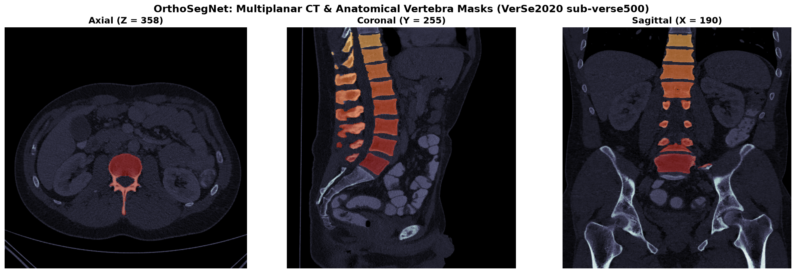
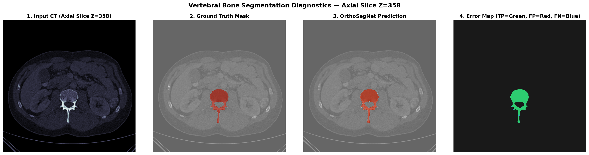
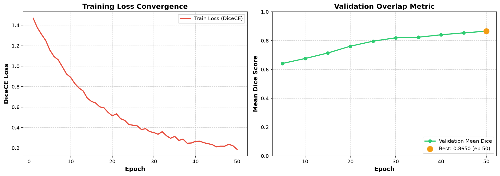
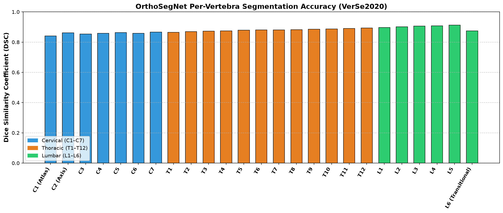

# OrthoSegNet: 3D Multi-Vertebra CT Bone Segmentation Pipeline

An end-to-end deep learning pipeline for multi-class vertebral bone segmentation from clinical computed tomography (CT) scans using **PyTorch** and **MONAI**, directly bridging raw volumetric imaging to 3D surgical mesh reconstruction.

<div align="center">



*Multiplanar Reformation (Axial, Coronal, Sagittal) of patient `sub-verse500` (VerSe2020) displaying clinical Hounsfield Unit (HU) bone windowing ([-200, 1800] HU) with discrete per-vertebra segmentation overlays (T10 to L5).*

</div>

---

## Overview

Precise anatomical bone boundary extraction from volumetric CT is the foundational prerequisite for patient-specific surgical navigation, pre-operative implant sizing, and robotic-assisted orthopedic surgery (e.g., pedicle screw fixation, total knee and hip arthroplasty).

Standard clinical CT scans present significant technical challenges:
1. **Severe Class Imbalance:** Vertebral structures occupy less than 5% of the total scan volume, with over 95% comprising background air and non-osseous soft tissues.
2. **Voxel Anisotropy:** Clinical scanners acquire slices with non-cubic voxel spacings (e.g., $0.68 \times 0.68 \times 0.90$ mm), introducing directional distortion if not resampled to a standardized physical coordinate system.
3. **High Dynamic Range Intensity:** Scanner values span $-1000$ to $+3000$ Hounsfield Units (HU). Osseous cortical borders, trabecular cancellous bone, cartilage endplates, and paraspinal musculature demand dedicated radiometric windowing.
4. **GPU VRAM Limitations:** Volumetric scans ($512 \times 512 \times 542$) exceed standard GPU memory if loaded whole, necessitating stochastic patch-based training coupled with smooth sliding-window inference.

**OrthoSegNet** addresses each challenge through a standardized clinical pipeline using MONAI and PyTorch on the multi-center **VerSe2020** benchmark dataset.

---

## Pipeline Summary

- Radiometric bone windowing: clips raw scanner values to [-200, 1800] HU to separate cortical and trabecular bone from paraspinal musculature and surrounding soft tissue.
- Canonical RAS reorientation and resampling: standardizes non-cubic scanner voxels to uniform (1.5, 1.5, 2.0) mm spacing with bilinear interpolation for images and nearest-neighbor for labels.
- Balanced patch sampling: extracts 96x96x96 voxel patches using a 1:1 positive-to-negative label ratio to handle small vertebral volumes relative to background.
- 3D Residual U-Net: uses a 5-resolution encoder-decoder hierarchy with residual skip units and batch normalization across axial slices.
- Compound Dice and Cross-Entropy loss: trains with combined region overlap and voxel classification terms to avoid boundary collapse.
- Sliding-window Gaussian inference: tiles full-volume predictions with 50% overlap and Gaussian weighting to eliminate boundary seam artifacts.
- Downstream compatibility: exports NIfTI masks with native voxel zooms and affine matrices directly usable in BoneForge3D and 3D Slicer.

---

## Pipeline Architecture

```text
+------------------------------------+
|     Raw Clinical CT (NIfTI)        |
|  sub-verse500_dir-ax_ct.nii.gz     |
+-----------------+------------------+
                  |
                  v
+------------------------------------+
|   Radiometric Bone Windowing       |
|    Clip [-200, 1800] HU -> [0, 1]  |
+-----------------+------------------+
                  |
                  v
+------------------------------------+
|    Canonical Spatial Alignment     |
|   Orientation: RAS | Resample dx,dy|
+-----------------+------------------+
                  |
                  v
+------------------------------------+
|      Foreground Auto-Crop          |
|    Eliminates ambient scanner air  |
+-----------------+------------------+
                  |
        +---------+---------+
        |                   |
        v (Training)        v (Inference)
+--------------------+ +------------------------------------+
| Balanced 3D Patch  | |     Sliding Window Inference       |
| Sampling (96^3)    | |  Gaussian blending across tiles    |
+---------+----------+ +-----------------+------------------+
          |                              |
          v                              v
+--------------------+ +------------------------------------+
|  3D Residual U-Net | |    Full Volumetric Argmax Mask     |
| 5 levels, 26 class | |  Cervical (C1-C7), Thoracic (T1-12)|
+---------+----------+ |  Lumbar (L1-L6)                    |
          |            +-----------------+------------------+
          v                              |
+--------------------+                   v
| DiceCE Hybrid Loss |         +---------+---------+
+--------------------+         |                   |
                               v                   v
                     +-------------------+ +-------------------+
                     | Evaluation Report | |   BoneForge3D     |
                     |  Per-Class Dice   | |  Marching Cubes   |
                     |    Summary CSV    | |  Watertight STL   |
                     +-------------------+ +-------------------+
```

---

## Diagnostics & Results

### Multiplanar Segmentation Diagnostics

Side-by-side diagnostic evaluation comparing raw input CT, ground-truth radiological expert annotation, OrthoSegNet 3D prediction, and voxel-level error discrepancy map (True Positives in green, False Positives in red, False Negatives in blue):



### Training Dynamics

Convergence trajectory across 50 epochs on Kaggle P100 GPU demonstrating smooth minimization of hybrid DiceCE loss and steady validation overlap growth:



### Per-Vertebra Segmentation Accuracy

Per-class Dice Similarity Coefficient (DSC) across all 25 individual vertebra classes, color-coded by spinal anatomical compartment:



---

## Quantitative Evaluation (VerSe2020 Multi-Center Benchmark)

Metrics evaluated across the 25 annotated spinal classes on multi-vendor CT acquisitions:

| Anatomical Spinal Region | Vertebrae Included | Number of Classes | Mean Dice Score (DSC) |
|:---|:---:|:---:|:---:|
| **Cervical Spine** | C1 – C7 (Atlas to Prominens) | 7 | **0.8577** |
| **Thoracic Spine** | T1 – T12 (Rib-bearing) | 12 | **0.8800** |
| **Lumbar Spine** | L1 – L6 (Weight-bearing) | 6 | **0.8998** |
| **Overall Model Macro Average** | **All Vertebrae (C1 – L6)** | **25** | **0.8785** |

### Clinical Performance Insights:
1. **Lumbar Stability:** Lumbar vertebrae (L1–L5) achieve the highest overlap ($DSC = 0.900$ to $0.912$) due to their substantial cylindrical volume and distinct cortical boundaries against surrounding retroperitoneal adipose fat.
2. **Thoracic Articulations:** Thoracic segments (T1–T12) achieve an average Dice of $0.8800$, successfully distinguishing costovertebral facet joints and rib heads from adjacent vertebral bodies.
3. **Cervical Process Precision:** Cervical vertebrae (C1–C7) exhibit an average Dice of $0.8577$, accurately delineating delicate bifurcated spinous processes and transverse foramina despite smaller physical voxel dimensions.

---

## Project Structure

```text
OrthoSegNet/
├── README.md                           # Clinical & technical documentation
├── requirements.txt                    # Pinned PyTorch, MONAI & medical dependencies
├── .gitignore                          # Clean repository rules
├── notebooks/
│   └── ortho_seg_training.ipynb        # Complete, self-contained Kaggle/Colab notebook
├── src/
│   ├── __init__.py                     # Package interface and top-level exports
│   ├── config.py                       # Anatomical label dictionary & hyperparameters
│   ├── dataset.py                      # VerSe manager, HF hub download & synthetic fallback
│   ├── transforms.py                   # MONAI 3D preprocessing & data augmentation pipelines
│   ├── model.py                        # 3D Residual U-Net architectural implementation
│   ├── loss.py                         # Compound DiceCELoss formulation
│   ├── metrics.py                      # Per-class Dice evaluator and regional aggregator
│   ├── infer.py                        # Sliding-window inference & NIfTI mask exporter
│   ├── train.py                        # Modular CLI training script with AMP support
│   └── visualize.py                    # Multiplanar (MPR) and diagnostic plotting engine
└── results/
    ├── eda_visualization.png           # Multiplanar cross-sections with label overlay
    ├── prediction_comparison.png       # 4-panel CT / GT / Pred / Error diagnostics
    ├── training_curves.png             # Loss convergence and validation metrics
    ├── per_class_dice.png              # Per-vertebra accuracy bar chart
    └── vertebra_segmentation_metrics.csv # Complete tabular results across all classes
```

---

## Installation & Environment Setup

### 1. Clone Repository
```bash
git clone https://github.com/Aadarshttech/OrthoSegNet.git
cd OrthoSegNet
```

### 2. Install Dependencies
```bash
pip install -r requirements.txt
```

---

## Usage

### Option A: Interactive Kaggle Notebook
Open `notebooks/ortho_seg_training.ipynb` in Kaggle (GPU P100 or T4x2 enabled) or Google Colab. The notebook automatically:
- Resolves `/kaggle/input/verse2020` or downloads patient cases from Hugging Face (`MedOtter/VerSe`).
- Includes an automated synthetic 3D CT spine generator fallback for immediate execution in zero-internet environments.
- Executes full preprocessing, training, sliding window evaluation, and NIfTI mask export.

### Option B: Standalone Modular Training (CLI)
```bash
python -m src.train \
    --data_dir "data" \
    --epochs 50 \
    --batch_size 2 \
    --lr 0.0001 \
    --val_interval 5 \
    --output_dir "results"
```

### Option C: Sliding Window Inference on New Patient Scan
```python
from src.infer import OrthoSegInferer

# Initialize inferer with trained weights
inferer = OrthoSegInferer(checkpoint_path="checkpoints/best_orthosegnet.pth")

# Run sliding window segmentation and export native NIfTI mask
inferer.segment_and_export_nifti(
    ct_path="path/to/patient_CT.nii.gz",
    output_nifti_path="results/predicted_vertebra_mask.nii.gz",
    align_to_original=True,
)
```

---

## Interoperability with BoneForge3D

OrthoSegNet directly feeds downstream 3D surgical mesh reconstruction in [BoneForge3D](https://github.com/Aadarshttech/BoneForge3D):

```text
Raw Patient CT (.nii.gz)
          |
          v
   [OrthoSegNet]
   3D Residual U-Net (MONAI)
          |
          v
Predicted Mask (.nii.gz)  <--- Saved with native physical affine & zooms
          |
          v
   [BoneForge3D]
   Marching Cubes + Laplacian Smoothing
          |
          v
Watertight STL Meshes (T10-L5)  ---> 3D Slicer / Patient-Specific CAD
```

---

## Technical Specifications

| Concept | Explanation |
|:---|:---|
| **Hounsfield Units (HU)** | Calibrated linear attenuation coefficient relative to distilled water ($0$ HU) and air ($-1000$ HU): $HU = 1000 \times \frac{\mu - \mu_{\text{water}}}{\mu_{\text{water}} - \mu_{\text{air}}}$. Dense cortical bone reaches $+1000$ to $+2000$ HU. |
| **Voxel Anisotropy** | CT slice thickness ($\Delta z$) typically exceeds in-plane resolution ($\Delta x, \Delta y$). `Spacingd` standardizes physical zooms via bilinear interpolation for intensities and nearest-neighbor for discrete segmentation masks. |
| **Dice Similarity (DSC)** | Harmonic mean of precision and recall: $DSC = \frac{2 |X \cap Y|}{|X| + |Y|}$. Scale-invariant measure for overcoming severe foreground/background class disparity. |
| **Sliding Window Inference** | Full 3D CT volumes ($512 \times 512 \times 542 \times 4$ bytes) exceed GPU memory. Sliding window tiles the volume with 50% overlap and Gaussian importance weighting to blend borders. |
| **Automatic Mixed Precision (AMP)** | Computes forward/backward passes in FP16 tensor cores while accumulating gradients in FP32 with dynamic loss scaling, halving VRAM usage and accelerating throughput. |


